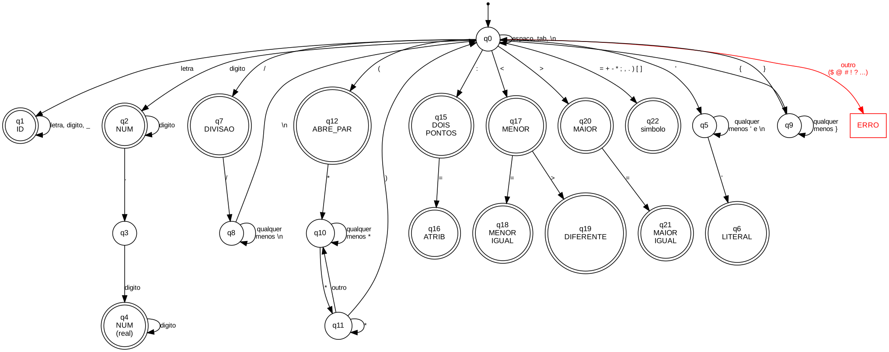

# PascaLex

Analisador léxico para um dialeto da linguagem Pascal, feito para o trabalho de Compiladores (UFES, Ciência da Computação). O nome que demos para a linguagem é PascaLex.

## Como rodar

Baixe a pasta e abra o `index.html` no navegador (Chrome, Firefox ou Edge). Não precisa instalar nada.

Na IDE dá pra criar, abrir e salvar arquivos `.pas`. O botão Compilar roda o analisador. Os erros também são verificados enquanto se digita: o trecho com erro fica sublinhado de vermelho e embaixo aparece a mensagem com linha e coluna. Clicando na mensagem o cursor vai até o erro.

Do lado direito tem duas abas: a lista de tokens encontrados e a tabela de símbolos.

## Arquivos

| Arquivo | O que faz |
|---|---|
| `index.html` | A IDE (editor, botões, tabelas e lista de erros) |
| `lexer.js` | O analisador léxico, função `analisar(codigo)` |
| `automato.dot` / `automato.png` | O autômato finito determinístico |
| `relatorio.pdf` | Relatório do trabalho |

Funcionamento: o editor (`index.html`) manda o texto para a função `analisar` (`lexer.js`), que devolve a lista de tokens, a lista de erros e a tabela de símbolos. A IDE então mostra isso na tela.

## Regras da linguagem implementadas

- Não diferencia maiúsculas de minúsculas (`BEGIN`, `Begin` e `begin` são a mesma coisa)
- Identificador começa com letra, depois pode ter letras, números e `_`, no máximo 15 caracteres
- Palavras reservadas: program, begin, end, var, const, procedure, function, integer, real, char, string, if, then, else, while, do, repeat, until, break, continue, for, to, or/ou, and/e
- Comentários (`// ...`, `{ ... }` e `(* ... *)`) e espaços em branco são descartados
- A tabela de símbolos já começa com as palavras reservadas, operadores e pontuação, e depois recebe os identificadores do programa

## Erros léxicos

| Erro | Exemplo |
|---|---|
| Caractere inválido | `total$`, `@`, `#`, `!`, `?` |
| Identificador com mais de 15 caracteres | `identificadorMuitoGrande` |
| Número mal formado | `12abc` |
| Literal sem fechar a aspa | `'texto` |
| Comentário sem fechar | `{ ...` ou `(* ...` |

Recuperação de erros: usamos o modo pânico. Quando acha um erro, o analisador guarda a mensagem com linha e coluna, pula o trecho errado e continua lendo. Assim aparecem todos os erros do programa de uma vez.

## Tokens

| Token | Exemplo de lexema | Expressão regular | Atributo |
|---|---|---|---|
| ID | `soma`, `total_1` | `[a-z][a-z0-9_]*` (até 15) | posição na tabela de símbolos |
| NUM | `10`, `2.5` | `[0-9]+(\.[0-9]+)?` | valor do número |
| LITERAL | `'ola'` | `'[^'\n]*'` | o texto |
| PROGRAM, BEGIN, END, VAR, CONST, PROCEDURE, FUNCTION | `program`, `begin`... | a própria palavra | - |
| INTEGER, REAL, CHAR, STRING | `integer`... | a própria palavra | - |
| IF, THEN, ELSE, WHILE, DO, REPEAT, UNTIL, BREAK, CONTINUE, FOR, TO | `if`... | a própria palavra | - |
| OU | `or`, `ou` | `or` \| `ou` | - |
| E | `and`, `e` | `and` \| `e` | - |
| ATRIBUICAO | `:=` | `:=` | - |
| IGUAL / DIFERENTE | `=` / `<>` | `=` / `<>` | - |
| MENOR / MENOR_IGUAL | `<` / `<=` | `<` / `<=` | - |
| MAIOR / MAIOR_IGUAL | `>` / `>=` | `>` / `>=` | - |
| MAIS / MENOS / MULT / DIVISAO | `+ - * /` | o próprio símbolo | - |
| PONTO_VIRGULA / DOIS_PONTOS / VIRGULA / PONTO | `; : , .` | o próprio símbolo | - |
| ABRE_PAR / FECHA_PAR / ABRE_COL / FECHA_COL | `( ) [ ]` | o próprio símbolo | - |

## Autômato

Estados com círculo duplo são finais (geram token). Qualquer caractere sem transição saindo de q0 vai para ERRO.

Para gerar a imagem de novo: `dot -Tpng automato.dot -o automato.png` (precisa do Graphviz).
